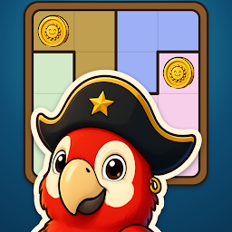
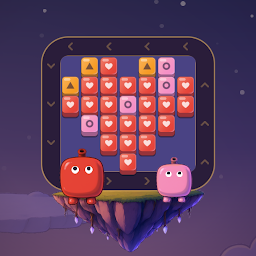
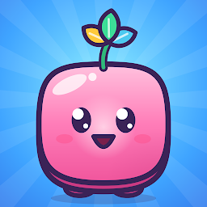
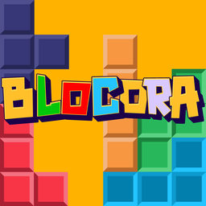
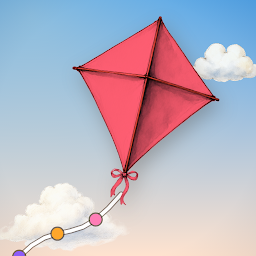
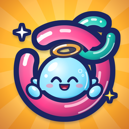

 

**Small, joyful games for the phone in your pocket.**
Easy to pick up, hard to put down, and made with care from the first pixel to the last sound.

[rickartics.com](https://rickartics.com) · [support@rickartics.com](mailto:support@rickartics.com)

 

## Games

<table>
  <tr>
    <td width="96" valign="top">
      
    </td>
    <td valign="top">
      <b>Celebrity Match</b> · Birthday twins · Android 
      Out now on <a href="https://play.google.com/store/apps/details?id=com.rickartics.celebritymatch">Google Play</a> · iOS coming soon
      
Enter your birthday and meet the actors, musicians, athletes and icons born on the very same day as you. Save your favourite stars, share your match, and get a nudge when someone you share a birthday with is celebrating. No sign-up: your birthday stays on your phone.

    </td>
  </tr>
  <tr>
    <td width="96" valign="top">
      
    </td>
    <td valign="top">
      <b>Pollydoku</b> · Logic grid puzzle · Android 
      Out now on <a href="https://play.google.com/store/apps/details?id=com.rickartics.pollydoku">Google Play</a>
      
Find the hidden gold with pure logic. A calm brain puzzle to think through at your own pace, with a new daily challenge to come back to.

    </td>
  </tr>
  <tr>
    <td width="96" valign="top">
      
    </td>
    <td valign="top">
      <b>Chroma Loop</b> · Color shooter puzzle · Android 
      Out now on <a href="https://play.google.com/store/apps/details?id=com.rickartics.chroma_loop">Google Play</a>
      
Send colour shooters round the conveyor loop and blast every pixel picture to pieces. Each shooter only hits the cubes on the edge it faces and the dock fills up fast, so the order you send them in is the whole game. Colour-blind mode included.

    </td>
  </tr>
  <tr>
    <td width="96" valign="top">
      
    </td>
    <td valign="top">
      <b>Dofus Guide</b> · Companion for Dofus Touch · Android 
      Out now on <a href="https://play.google.com/store/apps/details?id=com.rickartics.dofguide">Google Play</a> · iOS coming soon
      
Everything a Dofus Touch player needs in one pocket guide: classes and builds, a 1→200 leveling path, dungeons, the Dofus egg collection, professions and 100+ quick tips. Works fully offline, with no ads and no account.

      <i>Fan-made. Not affiliated with or endorsed by Ankama. Dofus is a trademark of Ankama.</i>
    </td>
  </tr>
  <tr>
    <td width="96" valign="top">
      
    </td>
    <td valign="top">
      <b>Trilly</b> · Tile match · Android 
      Coming soon to Google Play
      
Tap tiles into the tray and pop them in threes until the board is clear. Five candy worlds, a sticker album of 40 little critters, handy boosters and a lucky wheel every day, with Trilly the squishy tile cheering you on.

    </td>
  </tr>
  <tr>
    <td width="96" valign="top">
      
    </td>
    <td valign="top">
      <b>Blocora</b> · Block puzzle · iOS and Android 
      Coming soon to Google Play
      
A joyful block puzzle where every line you clear becomes a building, and the buildings grow into your own little borough. Play the same <i>Daily Block</i> as everyone else, once a day.

    </td>
  </tr>
  <tr>
    <td width="96" valign="top">
      
    </td>
    <td valign="top">
      <b>Kites Away</b> · Untangle puzzle · Android 
      Coming soon to Google Play
      
The festival sky is a tangle of kites. Tap one and it flies off the way it points, string and all, as long as nothing is in its way. Find the kite that's free, clear the sky and reveal a hidden pixel postcard.

    </td>
  </tr>
  <tr>
    <td width="96" valign="top">
      
    </td>
    <td valign="top">
      <b>Glassloop</b> · Ring puzzle · Android 
      Out now on <a href="https://play.google.com/store/apps/details?id=com.rickartics.glassloop">Google Play</a>
      
Hold a candy-glass ring and turn it with your finger until every link opens and it slips free into your jar. Pinned rings make each board a little logic puzzle. Five sunny worlds, gears, frost and keys, a daily puzzle, and Pip the glass buddy cheering you on.

    </td>
  </tr>
  <tr>
    <td width="96" align="center" valign="top">
      <h3>＋</h3>
    </td>
    <td valign="top">
      <b>More games in the works</b> 
      In development
      
New games are being built and played every day in the studio. We'll share them when they're ready.

    </td>
  </tr>
</table>

## How we make games

| | |
|---|---|
| **Learn** | You learn by playing. The first minute of every game teaches itself. |
| **Hold** | Made for one hand: portrait screens, short sessions, thumb-reachable controls. |
| **Offline** | Our games work without a signal. Accounts are for leaderboards, never a gate. |
| **Ours** | Art, sound and code are made in the studio. |

## Built with

 

Press, partnerships, publishing or a bug report: <a href="mailto:support@rickartics.com">support@rickartics.com</a>
