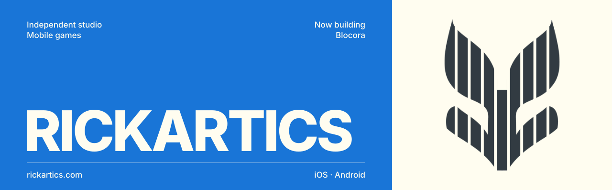
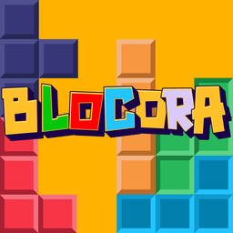

 

**Small, joyful games for the phone in your pocket.**
Easy to pick up, hard to put down, and made with care from the first pixel to the last sound.

[rickartics.com](https://rickartics.com) · [support@rickartics.com](mailto:support@rickartics.com)

 

## Games

<table>
  <tr>
    <td width="96" valign="top">
      
    </td>
    <td valign="top">
      <b>Celebrity Match</b> · Birthday twins · Android 
      Out now on <a href="https://play.google.com/store/apps/details?id=com.rickartics.celebritymatch">Google Play</a> · iOS coming soon
      
Enter your birthday and meet the actors, musicians, athletes and icons born on the very same day as you. Save your favourite stars, share your match, and get a nudge when someone you share a birthday with is celebrating. No sign-up: your birthday stays on your phone.

    </td>
  </tr>
  <tr>
    <td width="96" valign="top">
      
    </td>
    <td valign="top">
      <b>Blocora</b> · Block puzzle · iOS and Android 
      Coming soon
      
A joyful block puzzle where every line you clear becomes a building, and the buildings grow into your own little borough. Play the same <i>Daily Block</i> as everyone else, once a day.

    </td>
  </tr>
  <tr>
    <td width="96" valign="top">
      
    </td>
    <td valign="top">
      <b>Dofus Guide</b> · Companion for Dofus Touch · iOS and Android 
      Coming soon
      
Everything a Dofus Touch player needs in one pocket guide: classes and builds, a 1→200 leveling path, dungeons, the Dofus egg collection, professions and 100+ quick tips. Works fully offline, with no ads and no account.

      <i>Fan-made. Not affiliated with or endorsed by Ankama. Dofus is a trademark of Ankama.</i>
    </td>
  </tr>
  <tr>
    <td width="96" align="center" valign="top">
      <h3>＋</h3>
    </td>
    <td valign="top">
      <b>More games in the works</b> 
      In development
      
New games are being built and played every day in the studio. We'll share them when they're ready.

    </td>
  </tr>
</table>

## How we make games

| | |
|---|---|
| **Learn** | You learn by playing. The first minute of every game teaches itself. |
| **Hold** | Made for one hand: portrait screens, short sessions, thumb-reachable controls. |
| **Offline** | Our games work without a signal. Accounts are for leaderboards, never a gate. |
| **Ours** | Art, sound and code are made in the studio. |

## Built with

 

Press, partnerships, publishing or a bug report: <a href="mailto:support@rickartics.com">support@rickartics.com</a>
